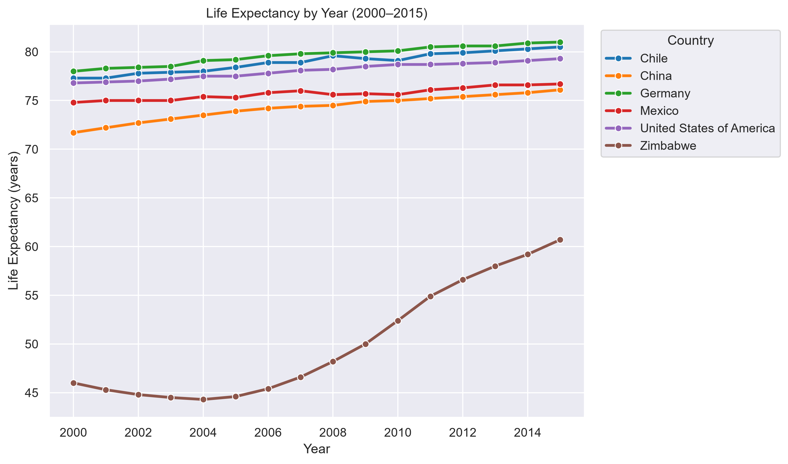
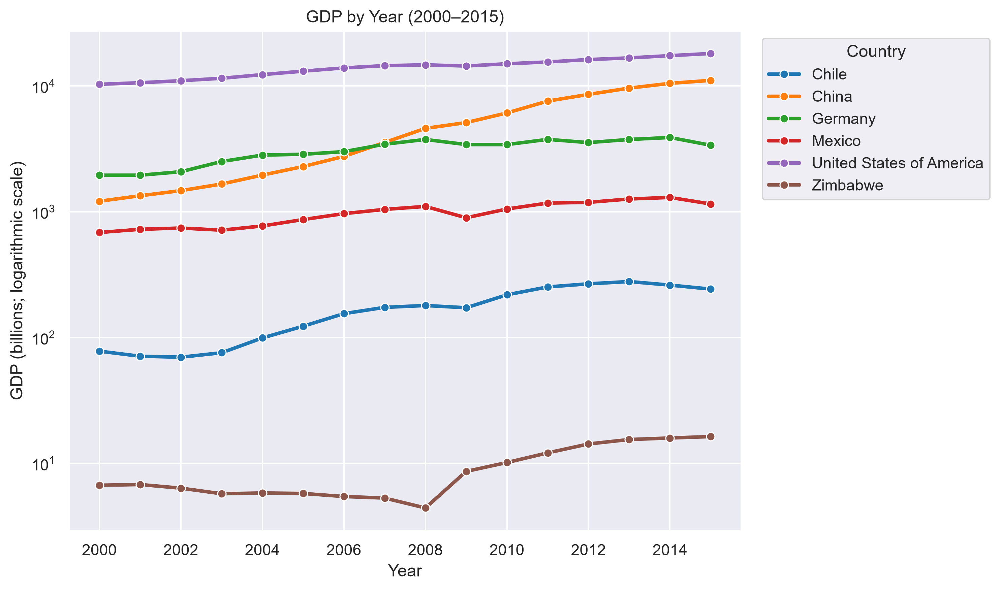
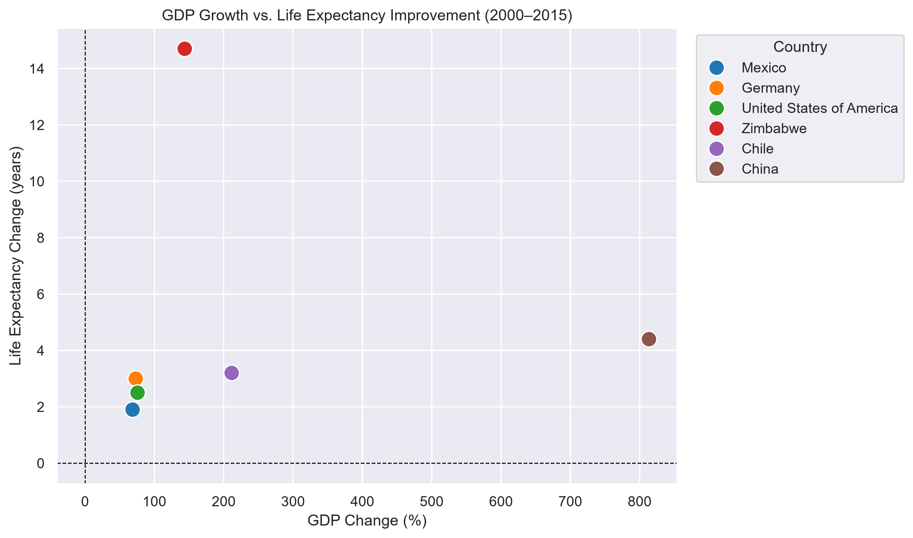

# Life Expectancy & GDP Analysis

## 1. Project Overview

This project explores the relationship between Gross Domestic Product (GDP) and life expectancy across six countries from 2000 to 2015.

Using Python, I performed data inspection, data preparation, exploratory data analysis, and visualization to investigate how economic growth and life expectancy changed over time.

The analysis focuses on the following countries:

- Chile
- China
- Germany
- Mexico
- United States of America
- Zimbabwe

The main objectives are to:

- Compare life expectancy trends across countries.
- Examine changes in GDP over the study period.
- Investigate the relationship between GDP and life expectancy.
- Compare economic growth with improvements in life expectancy.
- Identify patterns and differences between countries.

## 2. Key Findings

The analysis produced the following observations:

- **China recorded the largest GDP increase.** Its GDP increased by approximately 813.4% over the study period, while life expectancy improved by 4.4 years.
- **Zimbabwe recorded the largest improvement in life expectancy.** Life expectancy increased by 14.7 years, while GDP increased by approximately 143.7%.
- **Economic growth and improvements in life expectancy did not follow the same ranking.** China experienced the largest GDP increase, but Zimbabwe recorded the largest improvement in life expectancy.

These findings illustrate why economic growth and population health should be examined using multiple indicators rather than a single measure.

## 3. Visualizations

The following visualizations highlight the main findings of the analysis.

### Life Expectancy Trends

Compare changes in life expectancy across the six countries between 2000 and 2015.



### GDP Trends

Examine how GDP changed over time. A logarithmic y-axis made a difference between countries with substantially different GDP values easier to interpret.



### GDP Growth vs. Life Expectancy Improvement

Compare percentage GDP growth with the change in life expectancy for each country to explore whether the countries with the greatest economic growth also experienced the greatest improvements in life expectancy.




## 4. Tools and Skills

### Tools and Libraries

- **Python** — data analysis and scripting.
- **pandas** — data loading, inspection, cleaning, transformation, and aggregation.
- **Matplotlib** — data visualization.
- **Seaborn** — statistical visualization, where applicable.
- **Jupyter Notebook** — documenting and executing the analysis.
- **Visual Studio Code** — project development environment.
- **Git and GitHub** — version control and portfolio presentation.

### Skills Demonstrated

- Data quality assessment.
- Missing-value and duplicate checks.
- Exploratory data analysis (EDA).
- Descriptive statistics and country-level comparisons.
- Time-series trend visualization.
- Correlation analysis.
- Communicating analytical findings and limitations.

## 5. Project Structure

```text
life-expectancy-gdp/
├── README.md
├── data/
│   ├── raw/
│   └── cleaned/
├── notebooks/
│   ├── 01_data_inspection_and_preparation.ipynb
│   └── 02_exploratory_data_analysis_and_insights.ipynb
├── figures/
│   ├── life_expectancy_trends.png
│   ├── gdp_trends.png
│   └── gdp_growth_vs_life_expectancy_improvement.png
|   └── gdp_vs_life_expectancy_relationship.png
├── reports/
│   └── life_expectancy_gdp_analysis_case_study.pdf
├── requirements.txt
└── .gitignore
```

**Directory descriptions**

- `data/raw/` — the original dataset, preserved for reference.
- `data/cleaned/` — the prepared dataset used for analysis.
- `notebooks/` — notebooks documenting data inspection, preparation, exploration, visualizations, and findings.
- `figures/` — exported charts used in this README and other project documentation.
- `requirements.txt` — Python dependencies required to run the project.
- `.gitignore` — files and directories excluded from version control.

## 6. How to Run the Project

### Prerequisites

- Python 3.12 or another compatible Python version.
- Visual Studio Code with the Python and Jupyter extensions, or a Jupyter Notebook environment.
- Git (optional, for cloning the repository).

### Step 1: Clone the Repository

```bash
git clone (https://github.com/TekMasterSciences/life-expectancy-gdp-analysis.git)
cd life-expectancy-gdp-analysis
```

Alternatively, download the repository and open the project folder in Visual Studio Code.

### Step 2: Create and Activate a Virtual Environment

Create the environment:

```bash
python -m venv .venv
```

On Windows PowerShell, activate it:

```powershell
.\.venv\Scripts\Activate.ps1
```

### Step 3: Install Dependencies

```bash
python -m pip install -r requirements.txt
```

The `requirements.txt` file should include the libraries used by the notebooks, for example:

```text
pandas
matplotlib
seaborn
jupyter
ipykernel
```

### Step 4: Open the Notebooks

Open the `notebooks/` directory in Visual Studio Code.

Select the project's `.venv` Python interpreter and its corresponding Jupyter kernel.

Run the notebooks in order:

1. `01_data_inspection_and_preparation.ipynb`
2. `02_exploratory_data_analysis_and_insights.ipynb`

Ensure that the dataset is available at the file path specified in the notebook. If necessary, update the path to match your local directory structure.

## 7. Limitations

- **Correlation does not establish causation.** An observed relationship between GDP and life expectancy does not prove that economic growth directly causes improvements in life expectancy.
- **Limited country coverage.** The dataset includes only six countries, so the findings should not be generalized to all countries.
- **Limited time period.** The analysis covers 2000–2015 and does not represent more recent economic or health trends.
- **Other influencing factors.** Healthcare access, education, public policy, inequality, demographics, and other socioeconomic factors may influence life expectancy but are not fully examined in this project.
- **GDP interpretation.** GDP measures economic output, not how income or resources are distributed across a population. The interpretation of GDP trends also depends on how GDP is defined in the source dataset.

The results should therefore be interpreted as exploratory observations rather than evidence of causal relationships.

---

## Conclusion

This project demonstrates a Python-based analytical workflow, from data quality checks and preparation to exploratory analysis, visualization, and interpretation.

It highlights how data analysis can help compare economic and health indicators, identify differences between countries, and communicate findings while acknowledging the limitations of the available data.
